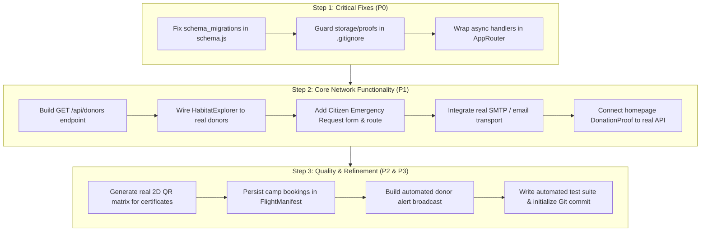

# RED MISSION — Pending Work & Implementation Roadmap

**Document Version**: 1.0.0  
**Phase**: Phase 1 Audit Handoff  
**Date**: November 8, 2026  
**Auditor**: Senior Full-Stack Developer, Software Architect, Security Auditor & QA Engineer  

This document organizes all pending, broken, simulated, and missing work identified during the Phase 1 audit by strict engineering priority:

- **P0 — Critical Security & Data-Loss Issues** (Must be fixed immediately before running or deploying).
- **P1 — Core Functionality** (Primary features required to make the platform operate as a true blood donation network).
- **P2 — Improvements & UI** (Feature enhancements, UX polishing, and non-blocking optimizations).
- **P3 — Deployment & Documentation** (Testing, containerization, git cleanliness, and production ops).

---

## Priority P0: Critical Security & Data-Loss Issues

### 1. Fix Database Bootstrap Crash on Fresh Deployments
- **Impact**: Server crashes with `SqliteError: no such table: schema_migrations` when started on a fresh system or when `red_mission.db` does not exist.
- **Root Cause**: In `server/database/schema.js`, tables 1–18 are defined, but `CREATE TABLE IF NOT EXISTS schema_migrations` is omitted. The migration files (`stage_2_2_donor_selfie.js`, `stage_2_4_photo_privacy.js`, `stage_2_5_emergency_workflow.js`) query this table on startup, triggering an uncaught exception.
- **Action Required**:
  - In `server/database/schema.js`, add:
    ```sql
    CREATE TABLE IF NOT EXISTS schema_migrations (
      version TEXT PRIMARY KEY,
      description TEXT NOT NULL,
      applied_at DATETIME DEFAULT CURRENT_TIMESTAMP
    );
    ```
  - Place this execution immediately prior to running `applyStage22Migration(db)`.

---

### 2. Guard Private Medical Proof Uploads in `.gitignore`
- **Impact**: Hospital donation proof slips uploaded by donors (which contain sensitive patient, doctor, and donor medical PII) are currently untracked and will be accidentally committed to public/private Git repositories.
- **Root Cause**:
  - `server/storage/proofs/*` is completely missing from `.gitignore`.
  - Line 68 of `.gitignore` has a typo (`!server/storage/selfies/.gitkeepssss`) preventing proper tracking of directory structure.
- **Action Required**:
  - Update `.gitignore` with:
    ```gitignore
    # Private donor and medical uploads
    server/storage/selfies/*
    !server/storage/selfies/.gitkeep
    server/storage/proofs/*
    !server/storage/proofs/.gitkeep
    ```
  - Create `server/storage/proofs/.gitkeep` if missing.

---

### 3. Prevent Unhandled Asynchronous Rejections in Custom HTTP Router
- **Impact**: Unhandled asynchronous promise rejections in route handlers bypass the router error trap, potentially destabilizing the Node.js process.
- **Root Cause**: In `server/index.js` (lines 178–193), `currentHandler(req, res, next)` is called within a synchronous `try/catch`. When `currentHandler` is `async` and rejects, synchronous `try/catch` cannot intercept the rejected Promise.
- **Action Required**:
  - Wrap handler execution in a Promise resolution chain:
    ```javascript
    Promise.resolve(currentHandler(req, res, next)).catch(next);
    ```

---

## Priority P1: Core Functionality

### 4. Implement Backend Live Donor Search & Directory Endpoint
- **Impact**: Real registered donors cannot be found by citizens in urgent need. `HabitatExplorer.jsx` currently searches a static hardcoded array (`INITIAL_DONORS`), meaning newly registered lifesavers are completely invisible.
- **Action Required**:
  - Create endpoint `GET /api/donors` in `server/routes/donorRoutes.js`:
    - Support query parameters: `bloodGroup`, `city`, `availableOnly`, `page`, `limit`.
    - Join `donor_profiles` with `users` (`full_name`, `blood_group`, `city`).
    - Privacy enforcement: Only return donors where `is_available_for_emergency = 1` or general voluntary registry. If `is_photo_public = 0`, return `photoUrl = null`. Never leak donor password salt, hashed tokens, or internal audit markers.
  - Refactor `src/components/HabitatExplorer.jsx`:
    - Replace `useState(INITIAL_DONORS)` with an asynchronous API fetch to `donorApi.search(...)`.
    - Remove the duplicate in-memory mock registration form on lines 98–137.

---

### 5. Build Public / Citizen Emergency Blood Request Workflow
- **Impact**: Citizens experiencing a family medical emergency cannot submit blood requests. Currently, only Admins with `MANAGE_REQUESTS` permission can create requisitions via `AdminDashboard.jsx`.
- **Action Required**:
  - Add backend route `POST /api/user/requests`:
    - Accessible to authenticated citizens (`authenticateUser`).
    - Accepts patient name, hospital name, city, address, blood group, units requested, urgency, contact name, contact phone, and optional clinical notes.
    - Status default: `OPEN` or `PENDING_REVIEW` (allowing hospital moderators to verify requisition legitimacy).
  - Add a "Create Blood Request" modal or button in `src/components/MissionLogs.jsx` that utilizes the passed `onAddRequest` handler.

---

### 6. Implement Real Transactional Email Service
- **Impact**: Email verification OTPs, password reset links, and admin invitation emails cannot be delivered to real users; currently they only print to server console logs.
- **Action Required**:
  - In `server/utils/mailer.js`, replace the `console.log` stub with a real transport:
    - Support standard SMTP credentials (`SMTP_HOST`, `SMTP_PORT`, `SMTP_USER`, `SMTP_PASS`) using `nodemailer`, or direct HTTPS API integration (e.g., SendGrid, Resend, or AWS SES).
    - Provide HTML email templates for:
      1. Registration Email OTP.
      2. Password Reset Token Link.
      3. Administrative Staff Invitation.

---

### 7. Connect Homepage Donation Proof Section to Real API
- **Impact**: The `#donation-proof` section on the homepage is a disconnected demo simulator that creates fake IDs (`SUB-xxxx`) with `setTimeout` timers instead of saving proof documents.
- **Action Required**:
  - Refactor `src/components/DonationProof.jsx`:
    - Check if user is authenticated.
    - If authenticated, display user's active unverified pledges and allow direct proof upload via `proofApi.upload(...)`.
    - If unauthenticated, display an informational banner guiding the donor to log in to submit proof for their emergency pledge.

---

### 8. Add General Donor Profile Editing Endpoint
- **Impact**: Donors cannot update their emergency availability, contact phone number, address pincode, or last donation date after initial registration.
- **Action Required**:
  - Add `PATCH /api/donor/profile` in `server/routes/donorRoutes.js`:
    - Allows updating `is_available_for_emergency`, `consent_emergency_alerts`, `pincode`, and `last_donation_date`.
  - Add an "Edit Donor Profile" form inside `src/components/auth/UserAccountMenu.jsx`.

---

## Priority P2: Improvements & UI

### 9. Genuine 2D QR Code Generation for Certificates
- **Impact**: Printed honor certificates cannot be scanned by mobile camera apps because the QR graphic in `CertificateModal.jsx` is a static Lucide icon (`<QrCode />`).
- **Action Required**:
  - Integrate a client-side QR generator (e.g. `qrcode` library or an inline SVG QR generator) that dynamically generates an authentic scannable 2D QR matrix for `${origin}/#verify-certificate-${token}`.

---

### 10. Persist Blood Donation Camp Bookings
- **Impact**: Slot reservations made in `#camps` (`FlightManifest.jsx`) are stored only in React state and vanish on page reload.
- **Action Required**:
  - Add routes:
    - `GET /api/camps`: Returns active mobile blood drives from `donation_camps` table.
    - `POST /api/camps/:id/register`: Records donor slot reservation in `camp_registrations` table.
  - Connect `FlightManifest.jsx` to load and reserve via these endpoints.

---

### 11. Implement Automated Emergency Broadcast Service
- **Impact**: The "SOS Broadcast" button in `AdminDashboard.jsx` only shows a local toast and does not alert donors.
- **Action Required**:
  - Add backend route `POST /api/requests/:id/broadcast` (Admin-only).
  - Queries `donor_profiles` for compatible blood groups in the hospital's city where `consent_emergency_alerts = 1`.
  - Records entries in `emergency_notifications`.
  - Dispatches SMS or WhatsApp messages containing the emergency deep link.

---

### 12. Connect Blood Drop AI to Real Generative AI / Gemini API
- **Impact**: `BloodDropModal.jsx` voice assistant is limited to 5 hardcoded dictionary responses.
- **Action Required**:
  - Integrate Gemini 1.5 Flash / 2.0 API via a secure backend route `POST /api/ai/query`:
    - Provide clinical blood donation grounding system prompts.
    - Return natural voice summaries and contextual UI action navigation.

---

### 13. Dead Code Clean-Up
- **Impact**: Unused legacy files increase project cognitive load.
- **Action Required**:
  - Safely remove `src/components/AuthModal.jsx` (legacy mock auth modal, 577 lines).
  - Safely remove or replace `src/components/CommTerminal.jsx`.

---

### 14. Code Splitting & Bundle Optimization
- **Impact**: Vite generates a single 995 kB JavaScript bundle, resulting in unnecessary download overhead on initial page load.
- **Action Required**:
  - Use `React.lazy()` and `Suspense` in `src/App.jsx` for heavy modal and dashboard components (`AdminDashboard`, `AdminManagementPanel`, `UserAccountMenu`, `BloodDropModal`).

---

## Priority P3: Deployment & Documentation

### 15. Automated Test Suite Implementation
- **Impact**: Zero automated tests currently exist (0% coverage).
- **Action Required**:
  - Install a lightweight test runner (e.g., `vitest` or Node's native `node:test`).
  - Add test script to `package.json`: `"test": "vitest run"` or `"test": "node --test"`.
  - Write unit tests for:
    - `server/utils/crypto.js` (password hashing, OTP generation/verification, token signing).
    - `server/utils/imageValidator.js` (magic byte checks, dimension validation, size limits).
    - `server/utils/sms.js` (phone normalization).
  - Write integration tests for:
    - Registration multi-step flow.
    - Login lockout on 5 failed attempts.
    - Dual 2FA verification.
    - Proof submission and approval.

---

### 16. Git Version Control Initialization & Clean Baseline Commit
- **Impact**: The repository has no Git commits yet (`No commits yet`); all files are untracked.
- **Action Required**:
  - Verify `.gitignore` contains `.env`, `*.db`, `backups/`, `dist/`, and `server/storage/proofs/*`.
  - Run `git add .` and create initial baseline commit:  
    `git commit -m "feat: Initial RED MISSION Phase 1 baseline codebase"`

---

### 17. Production Deployment & Process Management
- **Impact**: Platform requires documented production execution commands.
- **Action Required**:
  - Add `pm2.config.cjs` or a `Dockerfile` for Node.js v24 containerization.
  - Document Nginx / reverse proxy configuration with HTTP/2 and SSL certificates.
  - Set up automated daily SQLite backup scripts targeting `server/data/red_mission.db`.

---

## Recommended Implementation Order



---

*Document prepared by Senior Security & Full-Stack Audit Team for RED MISSION.*
